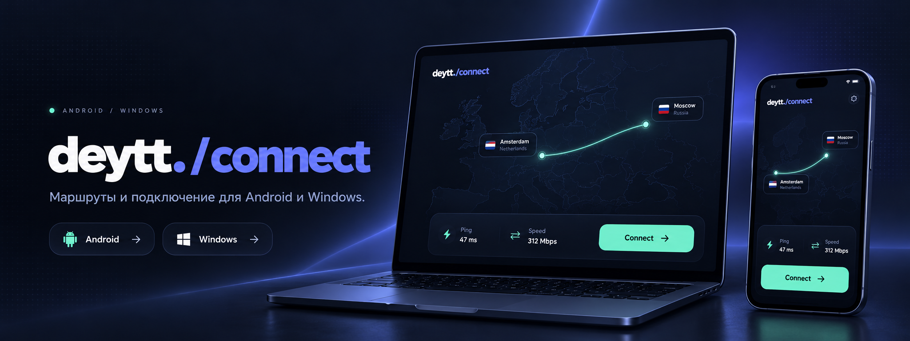

  

Клиент для выбора маршрута и подключения на Android и Windows

## 📥 Скачать

Выберите версию для своего устройства.

<table width="100%" align="center">
  <tbody>
    <tr>
      <td width="50%" align="center" valign="top">
        <h3>Android</h3>
        
Android 7+ &nbsp;·&nbsp; универсальный APK

        
        
SHA-256 — в релизе приложения нет в Google Play

      </td>
      <td width="50%" align="center" valign="top">
        <h3>Windows</h3>
        
Windows 10 (1809+) &nbsp;·&nbsp; x64 &nbsp;·&nbsp; v0.8.40

        
        
<a href="https://github.com/crxwov/deytt.connect/releases/download/v0.8.40/deytt-connect-0.8.40-portable.zip">ZIP без установки</a> &nbsp;·&nbsp; <a href="https://github.com/crxwov/deytt.connect/releases/tag/v0.8.40">SHA-256 и описание релиза</a> файлы не подписаны

      </td>
    </tr>
  </tbody>
</table>

> [!NOTE]
> Для входа используйте [Telegram-бота](https://t.me/deyttbot). Телефон и компьютер занимают разные слоты аккаунта.

## 🚀 Подключение

1. Установите приложение и войдите через Telegram.
2. Выберите «Авто» или нужный маршрут.
3. Нажмите **«Подключить»** и подтвердите запрос на подключение VPN.

> [!TIP]
> Не знаете, какой маршрут выбрать? Начните с «Авто».

### 📱 Android

Скачайте [APK из последнего релиза](https://github.com/crxwov/deytt.connect/releases/latest) и установите его. Если телефон попросит разрешение, подтвердите установку.

### 🪟 Windows

- **MSI:** запустите установщик. Если на компьютере нет [WebView2](https://developer.microsoft.com/microsoft-edge/webview2/), MSI может скачать его.
- **ZIP:** распакуйте архив и откройте `deyttconnect.exe`.
- При установке VPN-службы подтвердите запрос прав администратора Windows.

## 🧩 Протоколы

`VLESS` &nbsp;·&nbsp; `Trojan` &nbsp;·&nbsp; `Hysteria 2` &nbsp;·&nbsp; `AmneziaWG 3.1`

Доступность зависит от платформы и маршрута. [Условия и конфиденциальность](https://deytt.space/info/).

## 💬 Поддержка

[Telegram-бот](https://t.me/deyttbot) &nbsp;·&nbsp; [сообщить об ошибке](https://github.com/crxwov/deytt.connect/issues) &nbsp;·&nbsp; [сообщить об уязвимости](https://github.com/crxwov/deytt.connect/security/advisories/new) &nbsp;·&nbsp; [политика безопасности](SECURITY.md)

> [!WARNING]
> Сообщения об ошибках видны всем. Не публикуйте там коды входа, ссылки на подписку, VPN-ключи, конфигурации, IP-адреса или данные аккаунта.

📄 <a href="LICENSE">GNU GPL-3.0-or-later</a> &nbsp;·&nbsp; <a href="THIRD-PARTY-NOTICES.md">уведомления о сторонних материалах</a>

