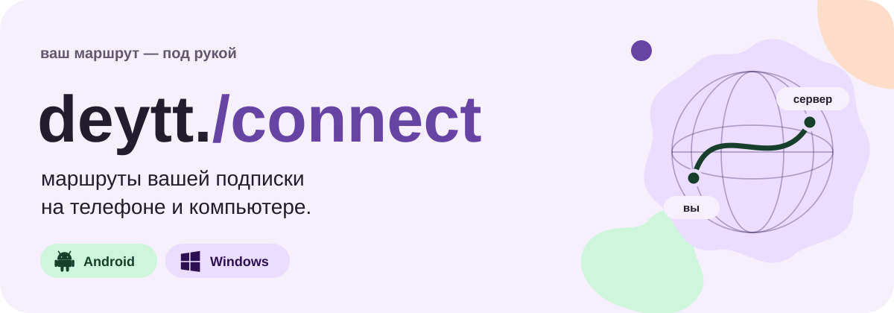
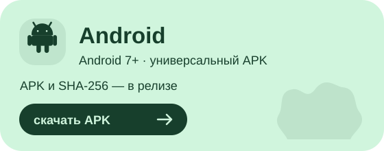
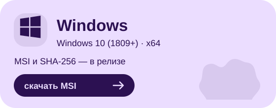

  <picture>
    <source media="(prefers-color-scheme: dark)" srcset="assets/readme-material/hero-dark.svg">
    
  </picture>
  

    <a href="#скачать">скачать ./connect</a>
    &nbsp;·&nbsp; <a href="#подключение">как подключить</a>
    &nbsp;·&nbsp; <a href="https://t.me/deyttbot">поддержка</a>
    &nbsp;·&nbsp; <a href="https://deytt.space/info/">условия и конфиденциальность</a>
  

## скачать

  <a href="https://github.com/crxwov/deytt.connect/releases"><picture><source media="(prefers-color-scheme: dark)" srcset="assets/readme-material/android-dark.svg"></picture></a>
  <a href="https://github.com/crxwov/deytt.connect/releases/latest"><picture><source media="(prefers-color-scheme: dark)" srcset="assets/readme-material/windows-dark.svg"></picture></a>

Для Android выбирайте релиз с <code>app-universal-release.apk</code> и его <code>.sha256</code>. Приложения нет в Google Play. Windows MSI и приложение не подписаны DEYTT.

> [!NOTE]
> Вход — через [Telegram-бота](https://t.me/deyttbot). Телефон и компьютер занимают разные слоты аккаунта.

## подключение

1. Установите приложение и войдите через Telegram.
2. Выберите «Авто» или нужный маршрут подписки.
3. Нажмите **«Подключить»**. На Android подтвердите системный запрос VPN.

> [!TIP]
> Начните с «Авто», если ещё не выбрали маршрут.

**Android.** Откройте скачанный APK в системном установщике. Если телефон запросит разрешение на установку, подтвердите его. Перед обновлением сверьте SHA-256 из того же релиза.

**Windows.** Запустите MSI и подтвердите права администратора для установки VPN-службы. Если WebView2 отсутствует, MSI установит его из подписанного установщика Microsoft; для загрузки нужен интернет. Если в выбранном релизе есть ZIP, распакуйте его и откройте <code>deyttconnect.exe</code>.

## маршруты и протоколы

<code>VLESS</code> &nbsp;·&nbsp; <code>Trojan</code> &nbsp;·&nbsp; <code>Hysteria 2</code> &nbsp;·&nbsp; <code>AmneziaWG 3.1</code>

Выбирайте автоматический маршрут или отдельный регион, проверяйте доступность, задержку и скорость. Набор протоколов и маршрутов зависит от платформы и активной подписки.

## поддержка

[Telegram-бот](https://t.me/deyttbot) &nbsp;·&nbsp; [сообщить об ошибке](https://github.com/crxwov/deytt.connect/issues) &nbsp;·&nbsp; [сообщить об уязвимости](https://github.com/crxwov/deytt.connect/security/advisories/new) &nbsp;·&nbsp; [политика безопасности](SECURITY.md)

В сообщении об ошибке укажите версию клиента, операционную систему и шаги воспроизведения.

> [!WARNING]
> GitHub Issues видны всем. Не публикуйте коды входа, ссылки подписки, VPN-ключи, конфигурации, IP-адреса или данные аккаунта.

<a href="LICENSE">GNU GPL-3.0-or-later</a> &nbsp;·&nbsp; <a href="THIRD-PARTY-NOTICES.md">сторонние компоненты</a> шрифты карточек: <a href="assets/readme-material/OFL-GoogleSansFlex.txt">Google Sans Flex</a> и <a href="assets/readme-material/OFL-RobotoFlex.txt">Roboto Flex</a> · SIL OFL 1.1

