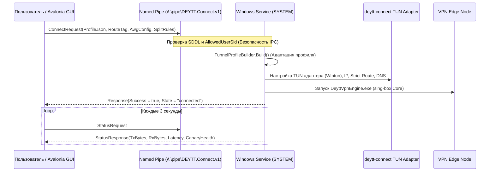

# Deytt Connect — Архитектура клиентской экосистемы

Документ описывает глобальную архитектуру клиентской системы **deytt./connect**, взаимодействие компонентов на Android и Windows, интеграцию с серверным флотом **deytt./vpn**, структуру туннелирования и модель безопасности.

---

## 1. Глобальная топология системы

```mermaid
flowchart TB
    subgraph Clients["Клиентские приложения (deytt./connect)"]
        subgraph AndroidClient["Android Client (:app)"]
            UI_A["Compose / Views UI (MainActivity, SetupActivity)"]
            VPN_A["ConnectVpnService / RouteProbeVpnService"]
            BOX_A["libbox JNI (sing-box 1.14.1)"]
            AWG_A["libdeytt-awg / libwg-go (AmneziaWG 1.5/3.1)"]
            XRAY_A["libXray (VLESS XHTTP CDN LTE)"]
            FLUX_A["libopenflux_jni (OpenFlux Tunnel)"]
        end

        subgraph WindowsClient["Windows Client (Avalonia 11)"]
            UI_W["DeyttConnect.Windows (User Session)"]
            PIPE["Named Pipe: \\\\.\\pipe\\DEYTT.Connect.v1 (SDDL)"]
            SVC_W["DeyttConnect.Windows.Service (NT AUTHORITY\\SYSTEM)"]
            BOX_W["DeyttVpnEngine.exe (sing-box Core)"]
            XRAY_W["xray.exe (CDN LTE Bridge)"]
        end
    end

    subgraph ServerFleet["Серверная инфраструктура (deytt.space)"]
        subgraph ControlPlane["Управляющий слой"]
            NGINX["Nginx Gateway (nl-site.conf / releases directio)"]
            ADMIN["vpn-admin (FastAPI: /api/tg/mobile/*, /sub/*)"]
            BOT["uebot (aiogram 3: Telegram Bot @deyttbot)"]
            MIRROR["/var/www/html/connect/releases (update.json, APK, MSI, ZIP)"]
        end

        subgraph EdgeNodes["VPN Edge Флот (Серверы выхода)"]
            NL["NL (Нидерланды) - VLESS / Trojan / Hysteria 2 / AWG"]
            DE["DE (Германия) - VLESS / Trojan / Hysteria 2 / AWG"]
            RU["RU (Россия) - VLESS / Trojan / Hysteria 2 / AWG"]
            FI["FI (Финляндия) - VLESS / Trojan / Hysteria 2 / AWG"]
            IT["IT (Италия) - VLESS / Trojan / Hysteria 2 / AWG"]
            RUDE["RU → DE (Транзитный каскад)"]
            LTE["CDN LTE (front.deytt.space:443 VLESS XHTTP)"]
        end
    end

    UI_A -->|HTTPS Pairing & Sub| ADMIN
    UI_W -->|HTTPS Pairing & Sub| ADMIN
    UI_W -->|IPC Stream| PIPE --> SVC_W
    SVC_W --> BOX_W
    SVC_W --> XRAY_W

    VPN_A --> BOX_A
    VPN_A --> AWG_A
    VPN_A --> XRAY_A
    VPN_A --> FLUX_A

    BOX_A & BOX_W -->|VLESS / Trojan / Hy2| EdgeNodes
    AWG_A & BOX_W -->|AmneziaWG UDP 1.5/3.1| EdgeNodes
    XRAY_A & XRAY_W -->|VLESS XHTTP CDN| LTE
    ADMIN --> BOT
    NGINX --> ADMIN
    NGINX --> MIRROR
```

---

## 2. Архитектура Android-клиента

Android-клиент `deytt./connect` построен на модульной архитектуре с поддержкой современных версий Android (API 24–35+) и изолированных процессов для высоконагруженных задач.

### 2.1. Изоляция процессов
Приложение разделено на 3 независимых процесса операционной системы Android:
1. **Основной процесс (`space.deytt.connect`)**:
   - UI (`MainActivity`, `SetupActivity`, `ProtocolActivity`, `NativeDocumentActivity`).
   - `ConnectVpnService` — системный `VpnService`, управляющий TUN-интерфейсом, маршрутизацией, DNS и туннельными библиотеками.
   - Кеш, настройки, локальное шифрование Keystore, параллельный загрузчик обновлений.
2. **Процесс зондирования маршрутов (`:routeprobe`)**:
   - Служба `RouteProbeVpnService`.
   - Изолированный легковесный процесс для измерения задержки (RTT, handshake, HTTP probe) и скорости по всем доступным точкам без влияния на основной пользовательский туннель.
3. **Процесс CDN LTE (`:xray`)**:
   - Служба `CdnLteXrayService`.
   - Запускает ядро `libXray` в выделенном процессе для обхода блокировок через Cloudflare CDN (VLESS XHTTP) с проксированием в локальный SOCKS5-лупбек.

### 2.2. Нативные библиотеки туннелирования (JNI / NDK)
- **`libbox.aar` (sing-box 1.14.1)**: Унифицированное ядро с поддержкой VLESS (Reality, WebSocket, gRPC), Trojan, Hysteria 2 и встроенного TUN (`gVisor`/`system`).
- **`libdeytt-awg.so` / `libwg-go.so` (`:awg-tunnel`)**: Кастомная сборка Go-бэкенда AmneziaWG с оверлеем для интеграции с жизненным циклом `VpnService` и поддержкой версий протокола 1.5 и 3.1 (расширенная обфускация заголовков, junk packets, init masks).
- **`libopenflux_jni.so` (`:openflux-tunnel`)**: Запатентованный высокопроизводительный транспорт OpenFlux на базе стека gVisor L4 и протокола Cups.
- **`libXray.aar`**: Полнофункциональный Xray-core для обслуживания гибридного CDN LTE маршрута.

---

## 3. Архитектура Windows-клиента

Клиент Windows спроектирован по модели **Client-Service (Split-Privilege Architecture)** для обеспечения безопасности и исключения работы UI с правами администратора.

### 3.1. Разделение привилегий
- **`DeyttConnect.Windows.exe` (Пользовательский процесс)**:
  - Выполняется в стандартной пользовательской сессии без повышенных привилегий (Non-Elevated).
  - UI на Avalonia 11 (XAML/C#), Microsoft Edge WebView2 для интерактивного глобуса маршрутов.
  - Клиент Telegram Pairing, парсер подписки, клиент проверки обновлений.
- **`DeyttConnect.Windows.Service.exe` (Системная служба `DEYTTConnectVpn`)**:
  - Выполняется под учетной записью `NT AUTHORITY\SYSTEM`.
  - Единственный компонент, имеющий право управлять сетевыми адаптерами, маршрутами Windows IP Helper API и файрволом.
  - Общается с GUI исключительно через локальный именованный канал `\\.\pipe\DEYTT.Connect.v1` с жестким дескриптором безопасности (SDDL).

---

## 4. Поток данных и авторизация (Telegram Pairing Flow)

1. **Запрос сопряжения**:
   - Клиент генерирует аппаратный идентификатор (`X-HWID`) и отправляет запрос `POST /api/tg/mobile/pair/start` с указанием Telegram username.
   - Сервер создает одноразовый вызов и возвращает ссылку на бота `https://t.me/deyttbot?start=pair_...`.
2. **Подтверждение в Telegram**:
   - Пользователь нажимает Start в боте; бот генерирует 6-значный одноразовый код.
3. **Верификация и получение токена**:
   - Пользователь вводит код в приложении -> `POST /api/tg/mobile/pair/verify`.
   - Сервер верифицирует сопряжение, регистрирует слот устройства (`happ_devices`) и выдает защищенный `app_token`.
4. **Загрузка и расшифровка профиля**:
   - Запрос `GET /sub/token/{app_token}?format=singbox`.
   - Сервер формирует персонализированный список доступных маршрутов (NL, DE, RU, FI, IT, RU-DE, LTE).
   - Приложение атомарно сохраняет и валидирует конфигурацию в защищенном локальном хранилище.

---

## 5. Модель отказоустойчивости и мониторинга (Canary Health)

- **DNS Detour & Bootstrap Protection**: В момент установления туннеля все DNS-запросы и адреса критических сервисов (`deytt.space`, Telegram API, canary эндпоинты) резолвятся до активации правила жесткой маршрутизации (`strict_route`), что исключает взаимную блокировку при старте.
- **Canary Probe**: Периодический опрос тестовых эндпоинтов (`cloudflare.com/cdn-cgi/trace`, `gstatic.com/generate_204`) через связанный TUN-интерфейс. В случае задержки или деградации клиент автоматически инициирует мягкое переподключение без обрыва UI.
- **Синхронизация с сервером**: При публикации релизов серверное зеркало Nginx на `deytt.space/connect/releases/` обеспечивает раздачу с максимальной пропускной способностью (directio, буферы 2M, sendfile), а клиенты используют сегментированное скачивание в 4 параллельных потока.
