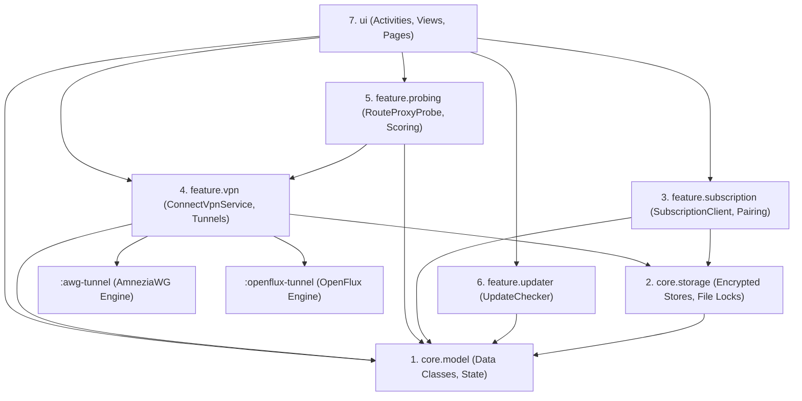
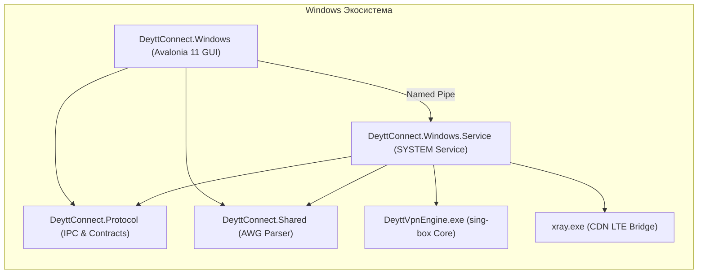

# Deytt Connect — Модульная архитектура и спецификация компонентов

Документ содержит исчерпывающее описание всех модулей, пакетов, нативных библиотек и проектов, входящих в состав экосистемы **deytt./connect**.

---

## 1. Общая модульная структура репозитория

```
deytt.connect/
├── app/                             # Android Application Module (:app)
│   ├── src/main/java/space/deytt/connect/
│   │   ├── core/model/              # 1. Доменные модели и бизнес-сущности
│   │   ├── core/storage/            # 2. Локальное хранилище, Keystore, транзакции
│   │   ├── feature/subscription/    # 3. Синхронизация подписки и Telegram Pairing
│   │   ├── feature/vpn/             # 4. VPN-службы, контроллеры и системные мосты
│   │   ├── feature/probing/         # 5. Движок зондирования и метрик маршрутов
│   │   ├── feature/updater/         # 6. Параллельный загрузчик обновлений
│   │   └── ui/                      # 7. UI: экраны, активности, глобус, диалоги
│   └── build.gradle.kts
├── awg-tunnel/                      # Android Library (:awg-tunnel) - AmneziaWG JNI & Go
├── openflux-tunnel/                 # Android Library (:openflux-tunnel) - OpenFlux JNI & Go
├── windows/                         # Windows Client Solution (.NET 10 / Avalonia 11)
│   ├── DeyttConnect.Protocol/       # IPC контракты, бинарный протокол, модели
│   ├── DeyttConnect.Shared/         # Парсер AmneziaWG INI/обфускации
│   ├── DeyttConnect.Windows.Service/# Системная служба управления туннелями
│   ├── DeyttConnect.Windows/        # Avalonia UI приложение
│   ├── installer/                   # WiX MSI инсталлятор и CustomActions
│   └── launcher/                    # C#/Go загрузчики и супервизоры
├── scripts/                         # Скрипты сборки, подписи релизов и утилит
└── docs/                            # Полный комплект технической документации
```

---

## 2. Модули Android-клиента (`app`)

Кодовая база Android разделена на 7 логических доменов с однонаправленным потоком зависимостей:



### 2.1. `core.model` (Доменные модели)
Чистые модели данных без тяжелых зависимостей от Android SDK:
- **`RouteModels.kt`**: Основные структуры описания маршрутов (`RouteCatalog`, `RouteEntry`, `ProtocolType`, `CountryGroup`, `AutoRouteSelection`).
- **`RuntimeProfile.kt`**: Нормализованное представление sing-box профиля, тегов выхода (`outbounds`) и DNS-параметров.
- **`VpnRuntimeState.kt`**: Состояния жизненного цикла подключения (`IDLE`, `PREPARING`, `CONNECTING`, `CONNECTED`, `DISCONNECTING`, `FAILED`).
- **`ProfileRoutes.kt` & `ProfileTraffic.kt`**: Модели трафика, лимитов квоты, времени действия подписки и активных сессий.
- **`ReleaseVersion.kt`**: Семантическое версионирование и сравнение релизов.
- **`LegalDocument.kt`**: Модели юридических документов (Условия использования, Политика конфиденциальности).
- **`TrafficActivityWindow.kt` & `ActiveRouteSelection.kt`**: Скользящее окно учета байт и фиксация выбранного маршрута.

### 2.2. `core.storage` (Хранилище и криптография)
Обеспечивает атомарную запись и аппаратное шифрование:
- **`LocalSecretCipher.kt`**: Симметричное шифрование AES-GCM с защитой ключа в аппаратном `AndroidKeyStore`. Предотвращает извлечение сессионных токенов при физическом дампе памяти.
- **`AtomicSubscriptionFile.kt`**: Транзакционная файловая система с журналированием (`.subscription-transaction.json`). Гарантирует целостность профилей при внезапном отключении питания устройства или краше ОС.
- **`SubscriptionStore.kt`**: Управление актуальным (`current.json`) и предыдущим (`previous.json`) профилями подписки с возможностью мгновенного отката.
- **`AwgProfileStore.kt`**: Хранилище сгенерированных конфигураций AmneziaWG (поколений 1.5 и 3.1).
- **`OpenFluxProfileStore.kt`**: Хранилище сессий и токенов OpenFlux.
- **`DailyUsageStore.kt`**: История суточного потребления трафика (за последние 30 дней) для графиков в профиле.
- **`LocalTrafficRecorder.kt`**: Высокоточный локальный счетчик байт на базе delta-сэмплов TUN-интерфейса.
- **`RouteQualityStore.kt`**: Долговременная история задержки (ping) и доступности каждого маршрута.
- **`TelegramIdentityCache.kt`**: Кеш Telegram-профиля (username, аватар, статус подписки).
- **`UserSplitTunnelStore.kt`**: Сохранение списков приложений и доменов для раздельного туннелирования.

### 2.3. `feature.subscription` (Синхронизация подписки и авторизация)
- **`SubscriptionClient.kt`**: Клиент получения профилей с `deytt.space`. Поддерживает параллельные запросы, проверку заголовка `X-Deytt-Cdn-Lte` и парсинг sing-box JSON.
- **`TelegramPairingClient.kt`**: Полный цикл привязки аккаунта Telegram (`pair/start` -> Challenge -> `pair/verify` -> Session Token).
- **`SubscriptionRequestIdentity.kt`**: Формирование системных заголовков: `X-HWID`, `X-Deytt-Client`, `X-TG-App-Token`, версии ОС и архитектуры.
- **`SubscriptionRetryPolicy.kt` & `SubscriptionRequestBudget.kt`**: Экспоненциальный backoff, тайм-ауты и ограничение частоты сетевых запросов.
- **`ProfileValidator.kt`**: Строгая валидация входящей JSON-конфигурации sing-box перед сохранением.
- **`SubscriptionErrorText.kt` & `SubscriptionLoadDiagnostics.kt`**: Локализация серверных кодов ошибок в понятные пользователю сообщения.

### 2.4. `feature.vpn` (Туннелирование и системные службы)
- **`ConnectVpnService.kt`**: Центральная служба Android `VpnService`. Создает TUN-интерфейс (`Builder`), устанавливает маршруты `0.0.0.0/0` и `::/0`, настраивает системный DNS и запускает нативный рантайм `libbox`.
- **`AwgTunnelController.kt` & `AwgDisconnectReceiver.kt`**: Управление AmneziaWG Go-бэкендом через IPC-сокет и обработка системных broadcast-интентов отключения.
- **`CdnLteXrayService.kt`**: Фоновая служба в процессе `:xray`, запускающая Xray VLESS XHTTP для резервного канала CDN LTE.
- **`RouteProbeVpnService.kt`**: Выделенная служба в процессе `:routeprobe` для фоновых измерений без перехвата трафика пользователя.
- **`TunnelCanary.kt`**: Механизм фонового мониторинга живости туннеля через контрольные HTTP-эндпоинты.
- **`SplitTunnelProfile.kt`**: Конфигурация списков включения/исключения пакетов (`addAllowedApplication`, `addDisallowedApplication`) и IP/доменных правил.
- **`ForegroundNotificationContract.kt`**: Управление уведомлениями переднего плана в соответствии с требованиями Android 14+ (`FOREGROUND_SERVICE_SYSTEM_EXEMPTED`).

### 2.5. `feature.probing` (Телеметрия и качество маршрутов)
- **`RouteProxyProbe.kt`**: Высокопроизводительный пул легковесных TCP/TLS зондов для параллельного замера RTT до серверов в NL, DE, RU, FI, IT.
- **`RouteProbeScoring.kt`**: Интеллектуальный алгоритм скоринга: расчет интегральной оценки (Grade A/B/C/D) на основе задержки, джиттера и потерь пакетов.
- **`RouteProbePresentation.kt` & `RouteProbeStatistics.kt`**: Форматирование данных для UI (цветовые индикаторы, среднее, лучшее и худшее время).
- **`RouteProbeCancellation.kt`**: Мгновенная отмена активных зондов при переключении экрана для экономии батареи и трафика.

### 2.6. `feature.updater` (Обновление приложения)
- **`UpdateChecker.kt`**:
  - Параллельная загрузка APK в 4 потока через HTTP Byte-Range запросы.
  - Первичное зеркало на `deytt.space/connect/releases/` с прямым доступом и fallback на GitHub Releases API.
  - Проверка контрольной суммы SHA-256 и верификация сигнатуры Android-пакета перед предложением установки.

### 2.7. `ui` (Пользовательский интерфейс)
- **Активности**: `MainActivity` (главный экран с ViewPager2), `SetupActivity` (вход через Telegram), `ProtocolActivity` (выбор и кастомизация протоколов), `NativeDocumentActivity` (просмотр правовых документов).
- **Экраны**: `TopLevelPages.kt` (Главная, Маршруты, Профиль, Настройки), `ProfileFlows.kt` (управление устройствами, тарифами, поддержка).
- **Визуальные компоненты**: `RouteGlobeView.kt` (3D интерактивный глобус на Canvas/WebGL), `ConnectionOrbView.kt` (неоновая сфера статуса подключения), `StarryPlanCard.kt` (интерактивная карточка тарифа с анимацией звездного неба), `AppDialog.kt` (фирменные диалоговые окна), `AppLanguage.kt` (полная двуязычная локализация RU/EN без внешних библиотек).

---

## 3. Модули Windows-клиента (`windows`)



### 3.1. `DeyttConnect.Protocol`
- **`WindowsPipeProtocol.cs`**: Реализация протокола именованного канала `\\.\pipe\DEYTT.Connect.v1`. Фрейминг: 4 байта LE (длина) + UTF-8 JSON.
- **`WindowsPipeCommand.cs` & `WindowsPipeResponse.cs`**: Команды `status`, `connect`, `disconnect`, `probe`, `cancel-probe`, `probe-progress`.
- **`TunnelProfileBuilder.cs`**: Транслятор абстрактного профиля в конечный конфиг sing-box:
  - Создание интерфейса `deytt-connect` (Wintun TUN).
  - Внедрение DNS-правил (прямой резолв canary-хостов).
  - Настройка списков процессов и доменов для Split Tunneling.
- **`CdnLteProfile.cs`**: Генератор конфигурации Xray для CDN LTE.

### 3.2. `DeyttConnect.Shared`
- **`WindowsAwgProfileParser.cs`**: Декодирование INI-конфигов AmneziaWG. Поддержка параметров: `Jc`, `Jmin`, `Jmax`, `S1`, `S2`, `S3`, `S4`, `H1`, `H2`, `H3`, `H4`, `I1`..`I5`, `HeaderProtectionKey`.
- Преобразование распарсенных ключей в JSON-структуру `outbound` типа `awg` для sing-box.

### 3.3. `DeyttConnect.Windows.Service`
- **`Program.cs` & `VpnWindowsService.cs`**: Точка входа Win32 Service (`DEYTTConnectVpn`).
- **`PipeServer.cs`**: Сервер именованного канала с проверкой SDDL и сопоставлением `AllowedUserSid` из ветки реестра `HKLM\SOFTWARE\DEYTT\Connect`.
- **`EngineController.cs`**: Супервизор процессов `DeyttVpnEngine.exe` и `xray.exe`. Мониторинг аварийного завершения, чтение stderr, graceful shutdown.
- **`RouteLatencyProbe.cs`**: Движок высокоточного замера задержек маршрутов на Windows через временные локальные прокси-порты.

### 3.4. `DeyttConnect.Windows`
- **`MainWindow.axaml`**: Главное окно Avalonia 11 с адаптивной компоновкой (полноэкранный десктопный режим с 3 панелями или мобильный компактный вид).
- **`RouteGlobeWebView.cs`**: Интеграция Microsoft Edge WebView2 с локальным веб-сервером ресурсов для отображения интерактивного глобуса без внешних сетевых запросов.
- **`TelegramApiClient.cs`**: Реализация Telegram Pairing для Windows.
- **`WindowsUpdateClient.cs`**: Двухуровневый клиент автообновления с верификацией ZIP-пакетов по SHA-256.

---

## 4. Нативные библиотеки туннелирования (C++ / Go)

### 4.1. `:awg-tunnel`
- **Исходный код**: Кастомная интеграция AmneziaWG Go бэкенда (`libwg-go.so`) и JNI-библиотеки (`libdeytt-awg.so`).
- **Особенности**:
  - Патч `goruntime-boottime-over-monotonic.diff` для корректного таймера в Android sleep mode.
  - Динамическая кодогенерация Java-обертки `GoBackend.java` на этапе Gradle build без модификации upstream-репозитория.
  - Поддержка AmneziaWG 1.5 и AmneziaWG 3.1.

### 4.2. `:openflux-tunnel`
- **Исходный код**: Нативный движок OpenFlux на C++/CMake с интеграцией Go-рантайма.
- **Особенности**:
  - Виртуальный стек TCP/IP на базе Google gVisor.
  - Протокол инкапсуляции Cups для максимального обхода DPI.
  - Минимальные накладные расходы по памяти и процессорному времени.

---

## 5. Матрица межмодульных зависимостей

| Модуль | Зависит от | Предоставляет API для |
| :--- | :--- | :--- |
| `core.model` | *Нет* (чистый Kotlin) | Всем модулям Android-приложения |
| `core.storage` | `core.model` | `feature.subscription`, `feature.vpn`, `ui` |
| `feature.subscription` | `core.model`, `core.storage` | `ui` |
| `feature.vpn` | `core.model`, `core.storage`, `:awg-tunnel`, `:openflux-tunnel` | `ui`, `feature.probing` |
| `feature.probing` | `core.model`, `feature.vpn` | `ui` |
| `feature.updater` | `core.model` | `ui` |
| `ui` | Всем доменным модулям | Конечный пользователь Android |
| `DeyttConnect.Protocol` | *Нет* (.NET 10 BCL) | `DeyttConnect.Windows`, `DeyttConnect.Windows.Service` |
| `DeyttConnect.Shared` | *Нет* (.NET 10 BCL) | `DeyttConnect.Windows`, `DeyttConnect.Windows.Service` |
| `DeyttConnect.Windows.Service` | `DeyttConnect.Protocol`, `DeyttConnect.Shared` | Служба Windows (SYSTEM) |
| `DeyttConnect.Windows` | `DeyttConnect.Protocol`, `DeyttConnect.Shared` | Конечный пользователь Windows |
