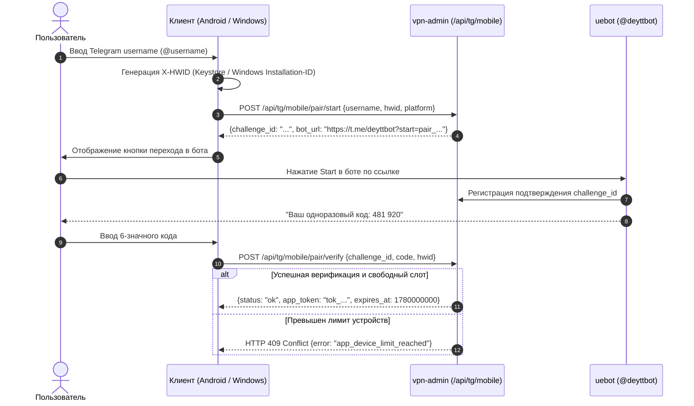

# Deytt Connect — Протоколы, туннелирование и интеграция

В этом документе детально описаны все сетевые и криптографические протоколы, поддерживаемые клиентами **deytt./connect**, параметры обфускации, интеграция гибридных каналов и протокол сопряжения Telegram.

---

## 1. Поддерживаемые протоколы туннелирования

Клиент `deytt./connect` поддерживает полный спектр современных протоколов обхода цензуры и DPI:

| Протокол | Транспорт | Ядро рантайма | Основное назначение |
| :--- | :--- | :--- | :--- |
| **AmneziaWG 1.5** | UDP | `:awg-tunnel` / `amnezia-box` | Быстрое подключение с легкой обфускацией заголовков WireGuard |
| **AmneziaWG 3.1** | UDP | `:awg-tunnel` / `amnezia-box` | Максимальная устойчивость к DPI: инъекция мусорных пакетов и маски |
| **VLESS** | TCP / Reality / XHTTP | `libbox` (sing-box) | Обход DPI через маскировку под легитимный TLS (Reality) |
| **Trojan** | TCP + TLS / WebSocket | `libbox` (sing-box) | Резервный протокол маскировки под HTTPS трафик |
| **Hysteria 2** | UDP / Brutal Congestion | `libbox` (sing-box) | Сверхвысокая скорость на нестабильных каналах (LTE, потери пакетов) |
| **CDN LTE** | VLESS XHTTP через Cloudflare | `libXray` + `libbox` | Обход тотальных белых списков мобильных операторов |
| **OpenFlux** | Cups Transport / gVisor | `:openflux-tunnel` | Индивидуальный высокопроизводительный L4 туннель |

---

## 2. AmneziaWG (Версии 1.5 и 3.1)

AmneziaWG модифицирует стандартный протокол WireGuard для предотвращения эвристического детектирования по сигнатурам рукопожатия (Handshake Initiation, Response, Cookie Reply).

### 2.1. Параметры обфускации
Конфигурация передается в формате INI (`[Interface]` и `[Peer]`) со специальными параметрами:

```ini
[Interface]
Address = 10.0.0.2/32, fd00::2/128
PrivateKey = aaaaaa...
DNS = 1.1.1.1, 8.8.8.8
Jc = 4                     # Junk packet count: количество случайных мусорных пакетов перед хэндшейком
Jmin = 50                  # Минимальный размер полезной нагрузки мусорного пакета (байты)
Jmax = 1000                # Максимальный размер полезной нагрузки мусорного пакета (байты)
S1 = 120                   # Размер первого сообщения инициализации handshake (байт)
S2 = 56                    # Размер ответа handshake (байт)
S3 = 88                    # Размер сообщения Cookie (байт)
S4 = 32                    # Размер сообщения Data (байт)
H1 = 12345678              # Магическое число заголовка Initiation
H2 = 87654321              # Магическое число заголовка Response
H3 = 11223344              # Магическое число заголовка Cookie
H4 = 44332211              # Магическое число заголовка Data

[Peer]
PublicKey = bbbbbb...
Endpoint = 198.51.100.1:443
AllowedIPs = 0.0.0.0/0, ::/0
# Расширенные параметры AmneziaWG 3.1:
i1 = 0x01,0x02,0x03        # Маска инъекции пакетов перед инициализацией
i2 = 0x04,0x05             # Маска инъекции пакетов после ответа
header_protection_key = ...# Дополнительный ключ шифрования заголовков
```

### 2.2. Различия между AWG 1.5 и AWG 3.1
- **AWG 1.5**: Базовая обфускация длин и заголовков пакетов (`Jc`, `Jmin`, `Jmax`, `S1`..`S4`, `H1`..`H4`).
- **AWG 3.1**: Включает алгоритмы инъекции случайных таймингов, поддержку динамических масок (`i1`..`i5`) и ключ `header_protection_key`. Клиент `deytt./connect` параллельно запрашивает профили обоих поколений и выбирает оптимальный в зависимости от доступности на стороне сервера.

---

## 3. Гибридный маршрут CDN LTE (Xray + sing-box)

Маршрут `route:DE:LTE` спроектирован для работы в условиях жестких блокировок мобильных операторов в РФ (блокировка UDP, WireGuard, прямого Reality).

```mermaid
flowchart LR
    App["Приложение пользователя"] -->|TUN (deytt-connect)| SingBox["sing-box Core"]
    SingBox -->|SOCKS5 Loopback (127.0.0.1:10808)| Xray["Xray Core (:xray)"]
    Xray -->|VLESS XHTTP / TLS| CF["Cloudflare CDN (front.deytt.space:443)"]
    CF -->|Proxy Egress| Origin["DE Edge Server"]
    Origin -->|Internet| Target["Целевой ресурс"]
```

### 3.1. Механизм передачи метаданных
1. Сервер передает метаданные в HTTP-заголовке `X-Deytt-Cdn-Lte` при запросе подписки.
2. Значение заголовка представляет собой Base64-строку, содержащую JSON-конфигурацию:
   ```json
   {
     "server": "front.deytt.space",
     "port": 443,
     "uuid": "xxxxxxxx-xxxx-xxxx-xxxx-xxxxxxxxxxxx",
     "path": "/cdn-stream-...",
     "host": "front.deytt.space",
     "sni": "front.deytt.space"
   }
   ```
3. Клиент генерирует изолированный конфиг для `xray` (`libXray` на Android, `xray.exe` на Windows), открывающий локальный порт SOCKS5 `127.0.0.1:10808`.
4. В конфигурации sing-box маршрут направляется в исходящий прокси типа `socks` на этот порт.
5. Защита от зацикливания: В правилах маршрутизации sing-box хост `front.deytt.space` маркируется как `direct` (в обход туннеля) во избежание рекурсивной блокировки.

---

## 4. Протокол сопряжения с Telegram (Pairing Protocol)

Авторизация клиентов осуществляется без логинов и паролей — через сопряжение с Telegram-ботом `@deyttbot`.



### 4.1. Аппаратный идентификатор (`X-HWID`)
- **Android**: Генерируется криптографически стойкий UUID, подписываемый ключом из аппаратного хранилища `AndroidKeyStore`.
- **Windows**: Сохраняется в файле `%LOCALAPPDATA%\DEYTT\Connect\installation-id`. Значение валидируется регулярным выражением UUIDv4.

### 4.2. Границы квот и лимит устройств
- В сервере действует единая база слотов устройств: `happ_devices`.
- Если у пользователя исчерпан лимит слотов (по умолчанию 3 или 5 в зависимости от тарифа), сервер возвращает `HTTP 409 Conflict` с ошибкой `app_device_limit_reached`.
- При удалении приложения или сбросе сессии клиент отправляет запрос на отвязку слота, освобождая его для других устройств.

---

## 5. Формат профиля подписки (sing-box JSON Schema)

Подписка отдается по адресу `GET /sub/token/{app_token}?format=singbox`. Основные секции:
1. **`dns`**: Настройки независимого резолвера, DoH (DNS over HTTPS), локальный fallback и правила detours.
2. **`inbounds`**: Описание TUN-адаптера (`type: tun`, `interface_name: deytt-connect`, `auto_route: true`, `strict_route: true`).
3. **`outbounds`**: Список серверов выхода:
   - `route:NL:VLESS` — Нидерланды (Reality)
   - `route:DE:Trojan` — Германия (Trojan)
   - `route:RU:HY2` — Россия (Hysteria 2)
   - `route:FI:VLESS` — Финляндия
   - `route:IT:Trojan` — Италия
   - `route:RUDE` — Каскадный выход: вход через РФ, транзит в DE
   - `direct` и `block` — Системные действия
4. **`route.rules`**: Правила раздельного туннелирования:
   - Домены `.ru`, `.xn--p1ai`, государственные сервисы -> `direct`.
   - Целевые заблокированные ресурсы -> активный `outbound`.
   - Защита локальной сети (`geoip:private`) -> `direct`.
